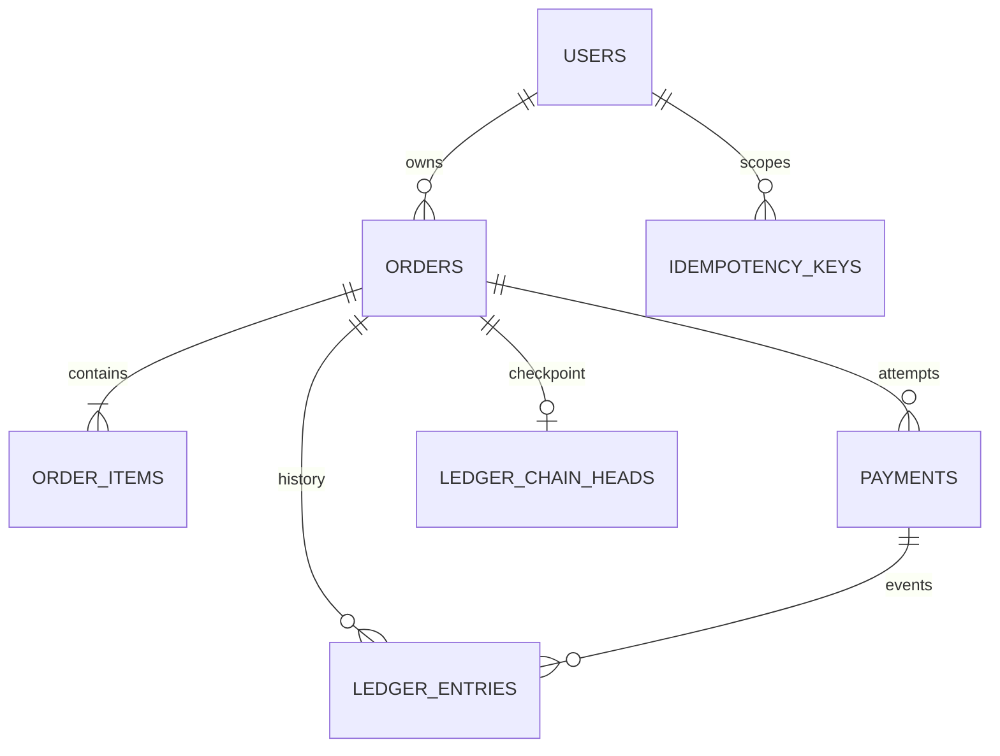
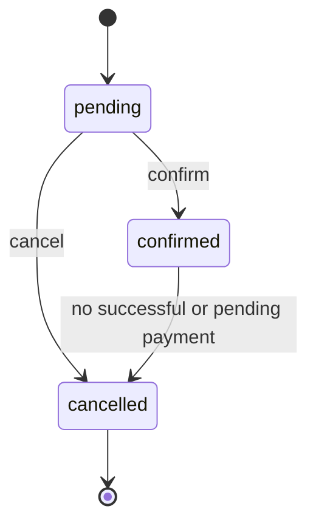
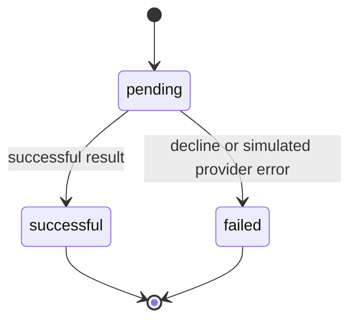

# System architecture

This API keeps mutable order/payment state and an append-only financial history.
Laravel 13 runs on PHP 8.3, Nginx and MySQL 8.4. JWT authenticates users. bcmath
handles exact decimal strings; no floating-point money arithmetic is used.

## Responsibilities and dependencies

| Module | Owns | Public boundaries |
|---|---|---|
| Auth | User, registration/login/logout | JWT user identity |
| Orders | Order aggregate, item data, policy, CRUD and state transitions | OrderReaderInterface + OrderSnapshotData; OrderPaymentGuardInterface implemented by Payments |
| Payments | Payment aggregate, gateway strategies, processing and queries | PaymentReaderInterface + PaymentData for ledger ownership |
| Ledger | Immutable entries, chain heads, hashing, recording and verification | Recorder/reader contracts + financial DTOs and enum value types |
| Shared | JSON errors, generic middleware, idempotency, DTO/support helpers | Generic reusable components |

Providers load module routes, migrations, configuration and bindings. Cross-module
code imports contracts/DTOs, never another module's Eloquent models, services or
controllers. Ledger HTTP ownership checks use reader contracts; the recorder and
hasher have no Orders/Payments persistence dependencies. Foreign keys are allowed.

Controllers validate through Form Requests, map a DTO, call a service and return
a Resource. Application services load, coordinate transactions, call aggregate
methods, save and dispatch events; they do not decide business eligibility.
OrderService's optional-item branch selects persistence for supplied data.
PaymentService selects cached domain attempts versus new processing; the aggregate
decides whether a new attempt is eligible. DTOs are typed readonly data objects.
OrderItem/IdempotencyKey are data; LedgerEntry adds only its immutability guard.

## Data and invariants



Ledger ids are plain identifiers without financial-history cascade deletion; the
diagram describes logical relationships. Payments restrict deletion of their
order/user at the database level. An order owns at least one item, calculates its
total server-side, and cannot be deleted once any payment exists. Amounts fit
DECIMAL(12,2); currency is configured (USD by default), not an FX conversion feature.



Only pending orders are editable. Cancelled is terminal. Confirmed orders can be
paid once successfully; failed attempts can be retried with a new key. Zero-value
orders are supported by the existing non-negative amount rule.



All transitions use aggregate methods; protected status/amount fields are not mass
assignable. Domain events dispatch after commit. There is no refund endpoint or
automatic recovery/reconciliation worker in this release.

## Payment processing

```mermaid
sequenceDiagram
    participant C as Client
    participant H as Auth / throttle / idempotency
    participant S as PaymentService
    participant D as MySQL
    participant G as Gateway strategy
    C->>H: POST + JWT + Idempotency-Key
    H->>D: Reserve request or replay exact response
    H->>S: Validated ProcessPaymentData
    S->>D: TX1: lock order, look up key, create pending + initiation memo
    D-->>S: Commit and release locks
    S->>G: Charge outside transaction (new attempt only)
    G-->>S: Sanitized deterministic outcome
    S->>D: TX2: aggregate outcome + ledger event
    D-->>S: Commit
    S-->>H: Safe PaymentData; dispatch domain events
    H->>D: Store exact response for replay
    H-->>C: 201 successful or failed payment
```

The order row serializes initiation, including different keys. Existing successful
payments reject new attempts; a pending attempt blocks other keys and cancellation.
The permanent per-order binary key and request fingerprint survive replay-cache
expiry. Same-key retries return existing state without charging again.

Idempotency middleware uses a per-user unique key, canonical method/path/query/body
hash, processing/completed states, and a 24-hour configurable TTL. Claim fencing
prevents a late request completing a replacement reservation. Only whitelisted
response headers and exact body bytes are replayed. Authentication and throttling
run first, so retries still count toward limits.

Ledger events are initiation/failure memos, success credits, and supported reversal
debits. A per-order chain-head lock serializes even the first append. Every entry
includes sequence, predecessor hash and canonical financial data; verification
also checks the head checkpoint to detect a removed tail. Model guards, database
triggers, read-only APIs and hashes provide the four planned integrity layers.

## Verification boundaries

Database-free unit tests exercise aggregate invariants and deterministic gateway
outcomes. MySQL integration tests cover transactions, triggers, tampering, owner
scoping, retry/cache-expiry safety and concurrent HTTP requests in separate PHP
processes. Documentation gates cover registered API routes and saved examples.
Postman/Newman exercises the deployed HTTP stack. These tests validate simulated
gateways; they do not certify a real provider integration or production operations.
